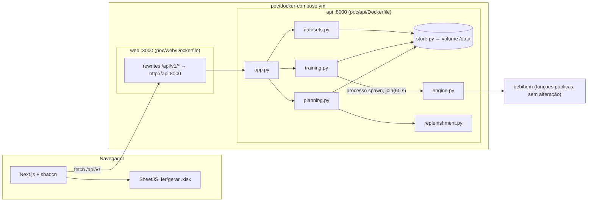
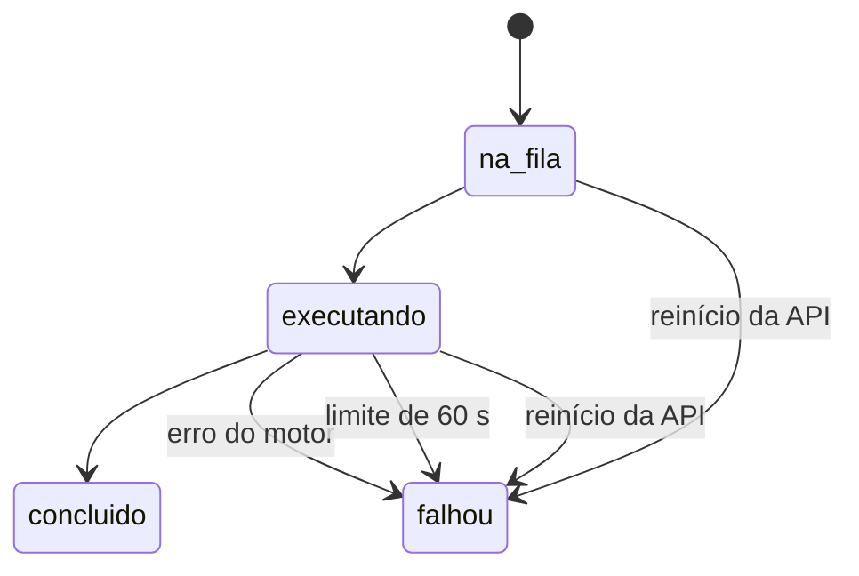

# POC Planejamento de Demanda Web — Design

**Spec:** `.specs/features/poc-demand-planning-web/spec.md`
**Context:** `.specs/features/poc-demand-planning-web/context.md`
**Status:** Aprovado (2026-09-30) — o mais simples possível, sem testes automatizados, shadcn na UI, **todo o POC numa pasta nova `poc/`**

Princípios:

1. **Pasta própria.** Todo o código, Docker e documentação do POC vivem em `poc/`. Nada fora de `poc/` e `.specs/` muda: pacote `bebibem`, CLI, notebook, testes, `pyproject.toml` e `README.md` da raiz ficam intactos (POC-05).
2. **Consome o pacote como biblioteca.** A API importa as funções públicas de `bebibem` por dependência de caminho; não copia nem altera o pacote.
3. **Menos arquivos, menos camadas.** API plana; web com 5 rotas.
4. **Sem testes automatizados.** A verificação é o roteiro manual V-01…V-20 em `tasks.md`.
5. **Re-treino em até 60 s**, com limite rígido (POC-40).

---

## Decisões vigentes do STATE.md

| AD | Tratamento |
| --- | --- |
| AD-001 uv + pyproject | **Conforma**: `poc/api/` é um projeto uv próprio (`pyproject.toml` + `uv.lock`) que depende de `bebibem` por caminho |
| AD-002 stack analítica | **Superseded por AD-020** (stack real inclui `statsmodels`) |
| AD-003 exportação de figuras | **Conforma**: vale para figuras do pacote; gráficos web não são exportados |
| AD-004 holdout 2024 | **Conforma**: CLI e notebook não mudam. O motor do POC usa janela móvel (AD-014, escopo `poc/`) |
| AD-005 duas imagens Docker | **Conforma**: `pipeline` e `jupyter` intactas. O POC tem **uma imagem FastAPI** (`poc/api/Dockerfile`) e **uma Next.js** (`poc/web/Dockerfile`) em `poc/docker-compose.yml` (AD-016) |
| AD-006 lógica em `src/bebibem` | **Conforma para o pacote**. O POC é um consumidor à parte (AD-019): reusa as funções de previsão do pacote, e a lógica exclusiva do POC (janela móvel, reposição) fica em `poc/api/` |
| AD-007 PT-BR | **Conforma** |
| AD-008 escalas | **Conforma**: tudo em unidades |
| AD-009 métricas + critério | **Conforma**: `bebibem.models.metrics` + `select_best` |
| AD-010, AD-012 | Não tocados |
| AD-011 previsão a partir de 2025-01 | **Conforma** no CLI; o POC começa no mês seguinte ao último observado (AD-015) |
| AD-013 regressões clássicas | **Conforma**: as 3 entram entre os 9 modelos |

---

## Approach Exploration

| Opção | Como funciona | Prós | Contras |
| --- | --- | --- | --- |
| **A — Motor do POC em `poc/api/` (escolhida)** | `poc_api/engine.py` recorta treino e holdout por data e chama funções **públicas** de `bebibem`. O treino roda em processo separado com limite de 60 s | Zero alteração fora de `poc/`; janela móvel; vencedor único dos 9; limite de tempo real | Repete a orquestração de `pipeline._backtest_product` (`src/bebibem/pipeline.py:287-358`); paridade conferida em V-02 |
| B — Refatorar o pipeline | Janela móvel no CLI | Uma implementação | Mexe no CLI e no notebook sem testes; contraria "deixe o notebook" |
| C — API chama o CLI | Subprocesso `bebibem-forecast` | Nada novo | ~100 figuras por treino; sem vencedor único; holdout fixo |
| D — Pré-computado | JSON estático | Trivial | Re-treino falso |

---

## Estrutura de pastas

```
poc/
  README.md                 # como subir, parar, zerar dados e o roteiro da demo
  docker-compose.yml        # serviços api e web (nenhum outro)
  .gitignore                # api/var/, web/node_modules/, web/.next/
  api/                      # FastAPI (projeto uv próprio)
    Dockerfile
    Dockerfile.dockerignore
    pyproject.toml          # fastapi, uvicorn[standard], bebibem (path = "../..")
    uv.lock
    src/poc_api/
      __init__.py
      app.py                # app FastAPI, lifespan, rotas, handler de erro
      schemas.py            # modelos Pydantic de entrada e saída
      store.py              # arquivos (única camada que toca disco)
      datasets.py           # caso/seed, importação, fechar mês, edição, diferença
      training.py           # processo de treino com limite de 60 s, ciclo de vida, ativação, comparativo
      planning.py           # plano, overview, settings, escolha manual
      engine.py             # motor: janela móvel + 9 modelos + vencedor + previsão
      replenishment.py      # regras de reposição
  web/                      # Next.js (Bun)
    Dockerfile
    .dockerignore
    package.json · next.config.ts · components.json
    src/…                   # ver "Web"
```

---

## Architecture Overview



### Estados do treino



---

## Code Reuse Analysis

Tudo reusado por **import** de `bebibem`, sem modificar arquivos.

| Função pública | Local | Uso no POC |
| --- | --- | --- |
| `load_demand`, `validate_frame`, `InputError` | `src/bebibem/io_data.py:244`, `:143`, `:17` | Carga do caso; validação das linhas importadas; mensagens PT-BR |
| `seasonal_index_matrix`, `cluster_months` | `src/bebibem/clustering.py:35`, `:93` | Clusters por mês: sobre a janela de treino (avaliação) e sobre o histórico todo (previsão), como o pipeline (`pipeline.py:709-760`) |
| `build_features`, `next_row` | `src/bebibem/features.py:46`, `:117` | Features ML |
| `build_estimators`, `metrics`, `select_best` | `src/bebibem/models.py:18`, `:29`, `:121` | Ridge / RF / GB; métricas AD-009; vencedor |
| `fit_final`, `forecast_recursive(start=…)` | `src/bebibem/forecast.py:21`, `:116` | Ajuste e previsão ML. **Sempre passar `start`** (o padrão `"2025-01"` está em `:121`) |
| `linear_regression_normal_equation`, `exponential_regression_loglinear`, `exponential_regression_normal_equation` | `src/bebibem/regression.py:60`, `:156`, `:161` | Os 3 clássicos (tendência `x = 0…n−1`); `applicable`/`note` dão o motivo quando não aplicável |
| `holt_winters_multiplicative`, `sarima_forecast`, `fourier_regression` | `src/bebibem/timeseries.py:65`, `:125`, `:197` | Os 3 de séries temporais: recebem a série de treino + horizonte |
| `SEED`, `MIN_OBS_FOR_ML`, `DEFAULT_INPUT` | `src/bebibem/config.py:18`, `:19`, `:14` | Semente, mínimo ML, CSV do caso |
| Padrão Docker uv + uid 10001 | `docker/pipeline.Dockerfile` | Base de `poc/api/Dockerfile` (padrão de referência, sem alterar o arquivo) |
| Regras do HTML de referência | `~/Downloads/previsao-compras-local.html:222–309`, `:460–475`, `:585–614` | Mapeamento, reposição, modelo de planilha, exportação (portados) |

**Não usar no motor** (presos a ano fixo): `features.split_train_holdout` (`features.py:81-84`), `timeseries.backtest_timeseries_product` / `evaluate_timeseries_dataframe` (`timeseries.py:273-275`, `:311-313`), `HOLDOUT_YEAR` / `FORECAST_YEAR` (`config.py:20-21`).

---

## Components

### `poc/api/src/poc_api/engine.py`

- **Purpose:** Avaliar os 9 modelos por produto na janela móvel, escolher o vencedor e prever. Devolve um `dict` pronto para JSON.
- **Interfaces:**
  - `MODEL_CATALOG: tuple[dict, ...]`: `{"modelo", "label", "familia"}` (tabela abaixo); fonte única de nomes PT-BR.
  - `MIN_HISTORY_MONTHS = 36`, `HOLDOUT_MONTHS = 12`.
  - `evaluate_and_forecast(frame: pd.DataFrame, horizon_years: int = 2, seed: int = SEED) -> dict`
    1. Valida: todos os produtos terminam no mesmo mês `U`, cada um com ≥ 36 meses e sem lacuna. Senão, `InputError` com produto, contagem e meses.
    2. Janela: holdout `U−11…U`; treino = meses anteriores.
    3. Por produto:
       - ML: `build_features` com clusters do treino → `fit_final` → `forecast_recursive(start=holdout_inicio)`;
       - clássicos: ajuste no `x` do treino → predição no holdout;
       - séries temporais: ajustador(treino, 12).
       - Em todos, `metrics` sobre o holdout.
    4. Vencedor = `select_best` sobre os aplicáveis; `rank` por aplicação sucessiva. Nenhum aplicável → `InputError`.
    5. Previsão futura de cada modelo aplicável:
       - ML: histórico todo e `start=U+1`;
       - clássicos: ajuste em todo `x` e predição de `n…n+12h−1`;
       - séries temporais: ajustador(histórico, 12h).
       - Valores negativos truncados em 0, com aviso.
  - Sem CV interna e sem figuras (tempo, POC-40).
- **Dependencies:** funções públicas da tabela acima.

| `modelo` | `label` | `familia` |
| --- | --- | --- |
| `ridge` | Ridge | ml |
| `random_forest` | Random Forest | ml |
| `gradient_boosting` | Gradient Boosting | ml |
| `linear_normal_equation` | Regressão linear | classica |
| `exponential_loglinear` | Exponencial (log-linear) | classica |
| `exponential_normal_equation` | Exponencial (equação normal) | classica |
| `holt_winters_multiplicative` | Holt-Winters multiplicativo | series_temporais |
| `sarima` | SARIMA | series_temporais |
| `fourier_harmonic` | Harmônicos de Fourier | series_temporais |

### `poc/api/src/poc_api/replenishment.py`

- **Purpose:** Regras de reposição (POC-06…13, AD-018), portadas de `previsao-compras-local.html:460–475`.
- **Interfaces:**
  - `SERVICE_LEVEL_Z = {"0.90": 1.2816, "0.95": 1.6449, "0.975": 1.96, "0.99": 2.3263}`
  - `STATUS_ORDER = ("ruptura", "comprar", "adequado", "excesso")`
  - `accuracy(mape) -> float | None`: `max(0, 100 − mape)`
  - `plan_product(forecast: list[float], rmse: float, position: dict, params: dict) -> dict`, com o formato `ProductPlanRead` (Data Models).
  - `demo_positions(frame: pd.DataFrame, seed: int = SEED) -> dict` (A14):
    - para cada produto, sendo `m` a média mensal dos últimos 12 meses:
      - `estoque = randint(0, round(3·m))`;
      - `a_receber = randint(0, round(m))`;
      - `lead_time = 1`; `multiplo = None`; `capacidade = None`;
    - gerador `numpy.random.default_rng(seed)`: os mesmos valores a cada seed ou "Usar dados do caso".

### API — `poc/api/src/poc_api/`

#### `app.py`

- `app = FastAPI(lifespan=lifespan)`. O `lifespan`: `store.init()` → `training.recover_interrupted()` → se vazio, `datasets.seed()` + `training.start()`.
- `class ApiError(Exception): status; codigo; mensagem; detalhes` + handler → `{"erro": {"codigo", "mensagem", "detalhes"}}`. `InputError` → 422 `validacao_invalida`. `detalhes` limitado a 20 + `"… e mais N"`.
- Env: `POC_DATA_DIR` (padrão `./var`), `POC_HORIZON_YEARS` (padrão 2), `POC_TRAINING_TIMEOUT_S` (padrão 60; sobrescrever só para a verificação V-18). A mensagem de estouro é "Tempo limite de {N} s excedido".

#### Rotas (`/api/v1`)

| Método | Rota | Corpo / query | Sucesso | Erros |
| --- | --- | --- | --- | --- |
| GET | `/health` | — | 200 `{"status":"ok"}` | — |
| GET | `/overview` | — | 200 `OverviewRead` | — |
| GET | `/datasets` | — | 200 lista | — |
| GET | `/datasets/{id}` | — | 200 com linhas (grade) | 404 |
| POST | `/datasets/import` | `DatasetImport` | 201 `ImportResult` | 409, 422 |
| POST | `/datasets/case` | — | 201 `ImportResult` | 409 |
| POST | `/datasets/{id}/close-month` | `CloseMonth` | 201 `ImportResult` | 404, 409, 422 |
| POST | `/datasets/{id}/edits` | `DatasetEdits` | 201 `ImportResult` | 404, 409, 422 |
| POST | `/runs` | `{dataset_id, horizon_years}` | 202 `RunRead` | 404, 409, 422 |
| GET | `/runs` | — | 200 lista (mais novo primeiro) | — |
| GET | `/runs/{id}` | — | 200 `RunRead` + `RunResult` | 404 |
| POST | `/runs/{id}/activate` | — | 200 | 404, 409 |
| GET | `/runs/compare` | `base`, `alvo` | 200 `CompareRead` | 404, 409, 422 |
| PUT | `/runs/{id}/model-choice` | `{produto, modelo \| null}` | 200 `PlanRead` | 404, 409, 422 |
| GET | `/plan` | — | 200 `PlanRead` | 404 sem ativa |
| GET | `/settings` | — | 200 `WorkspaceSettings` | — |
| PUT | `/settings` | `WorkspaceSettings` | 200 | 422 |

`ImportResult = {dataset, run | null, avisos}`. Import, caso e fechamento aceitam `iniciar_treino` (padrão `true`) e chamam `training.ensure_idle()` **antes** de gravar (POC-20).

#### `store.py`

```
<POC_DATA_DIR>/datasets/<id>/meta.json · rows.csv
<POC_DATA_DIR>/runs/<id>/run.json · result.json
<POC_DATA_DIR>/active.json · settings.json
```

- Escrita atômica (`tmp` + `os.replace`). JSON inválido → `ApiError(500, "armazenamento_invalido")`.
- IDs: `ds-<UTC YYYYmmddTHHMMSS>-<4 hex>`, `run-<UTC>-<4 hex>`.

#### `datasets.py`

- `seed()` / `load_case()`: `load_demand(DEFAULT_INPUT)`, `origem="caso"`, `settings.posicoes = demo_positions(frame)`.
- `import_rows`, `close_month`, `apply_edits`, `diff`: como no spec (POC-15…18, POC-35, POC-22).

#### `training.py` — processo com limite de 60 s (POC-40)

- `ctx = multiprocessing.get_context("spawn")`; um treino por vez (`lock` + `ensure_idle()` → 409).
- `start(dataset_id, horizon_years)`:
  - grava `na_fila`;
  - abre `ctx.Process(target=run_job, args=(rows_csv, result_path, horizon_years, seed))`;
  - uma thread vigia marca `executando` e faz `process.join(timeout=60)`.
- `run_job` (função de topo) chama `engine.evaluate_and_forecast` e grava `result.json` (ou `error.json` com a mensagem).
- Na volta da vigia:
  - processo vivo → `terminate()` + `falhou` "Tempo limite de 60 s excedido";
  - `result.json` existe → `concluido` com `duracao_s` e `set_active`;
  - `error.json` → `falhou` com a mensagem.
  - Log estruturado em cada transição (POC-34).
- `recover_interrupted()`: `na_fila|executando` → `falhou` "Interrompido pelo reinício do serviço".
- `activate(run_id)`: só `concluido`, senão 409 `treino_nao_concluido`.
- `compare(base, alvo)`: POC-22 + `datasets.diff`.

#### `planning.py`

- `plan()`: resultado ativo + `settings` + escolhas manuais.
  - Por produto: modelo em uso, `plan_product`, faixa `max(0, f − MAD)…f + MAD`.
  - KPIs; ordenação por `STATUS_ORDER` e necessidade decrescente; horizonte limitado a `min(24, 12h)`.
- `overview()`, `save_settings()` (faixas de POC-26 e POC-30), `set_model_choice()`.

#### `poc/api/pyproject.toml`

- `dependencies = ["fastapi", "uvicorn[standard]", "bebibem"]`, com `[tool.uv.sources] bebibem = { path = "../..", editable = true }`.
- Build backend `hatchling`, layout `src/` (AD-001).
- Desenvolvimento local: `cd poc/api && uv run uvicorn poc_api.app:app --reload`.

### Web — `poc/web/` (Next.js App Router + Bun + Tailwind + shadcn/ui)

Simplificações sobre o `rsys-frontend-stack`:
- sem Auth.js;
- tipos TypeScript em vez de Zod;
- linter padrão do `create-next-app`;
- TanStack Query mantido para polling e invalidação.

```
poc/web/
  next.config.ts                 # output "standalone"; rewrites /api/v1/:path* → ${INTERNAL_API_URL}/api/v1/:path*
  src/config/brand.ts            # nome neutro "Planejamento de Demanda", slogan, cor, sem logo (POC-24)
  src/app/layout.tsx · providers.tsx
  src/app/page.tsx               # landing
  src/app/app/layout.tsx         # sidebar: Painel · Modelos · Dados · Versões + indicador de treino
  src/app/app/page.tsx           # painel: KPIs, parâmetros, tabela, Sheet de detalhe, Dialog de estoque
  src/app/app/modelos/page.tsx
  src/app/app/dados/page.tsx     # Tabs: Importar · Fechar mês · Grade
  src/app/app/versoes/page.tsx   # lista + comparar
  src/components/*.tsx · src/components/ui/* (shadcn)
  src/lib/api.ts                 # tipos + apiFetch + ApiError/ApiUnavailable + hooks TanStack
  src/lib/format.ts
  src/lib/spreadsheet.ts         # SheetJS (versão corrigida do canal oficial)
  src/lib/help.ts                # textos de ajuda (lead time)
```

- **Componentes shadcn:** `button`, `card`, `badge`, `table`, `tabs`, `dialog`, `sheet`, `select`, `input`, `label`, `sidebar`, `sonner`, `skeleton`, `alert`, `progress`, `tooltip`, `chart`.
- **Ajuda de lead time (POC-26/28/30):** ícone de informação (`tooltip`) ao lado de todo rótulo "Lead time", com o texto de `help.ts`: "Lead time é o tempo, em meses, entre fazer o pedido de compra e a mercadoria chegar ao estoque. É usado no estoque de segurança e no prazo 'Comprar até'." No `Dialog` "Estoque e capacidade", o mesmo texto aparece também como descrição fixa abaixo do campo.

| Rota | Conteúdo | Requisitos |
| --- | --- | --- |
| `/` | Hero, faixa de números (API), problema, como funciona, por que confiar, CTA | POC-23, 24 |
| `/app` | KPIs, parâmetros (com ajuda de lead time), tabela, filtros, exportação; `Sheet` de detalhe; `Dialog` "Estoque e capacidade"; aviso de API indisponível | POC-12, 13, 25–28, 30, 32, 36–38 |
| `/app/modelos` | Seletor de produto, 9 modelos, janela, critério, gráfico do holdout | POC-29 |
| `/app/dados` | Importar, Fechar mês + progresso (+ horizonte 1–3), Grade | POC-15–18, 20, 31, 35, 39, 40 |
| `/app/versoes` | Lista, ativar, comparar base × alvo | POC-21, 22 |

### Empacotamento — uma imagem FastAPI + uma imagem Next.js + `poc/docker-compose.yml`

**Regra (pedido do usuário):** exatamente duas imagens próprias, uma por aplicação, e um único `docker-compose.yml`, na raiz da pasta `poc/`, que sobe as duas. A FastAPI não serve a web e o Next.js não embute a API. As imagens `pipeline` e `jupyter` (AD-005) ficam fora.

| Imagem | Dockerfile | Contexto de build | Conteúdo | Porta | Usuário |
| --- | --- | --- | --- | --- | --- |
| FastAPI | `poc/api/Dockerfile` (+ `Dockerfile.dockerignore`) | raiz do repositório (precisa de `src/bebibem`, `pyproject.toml` da raiz e `data/raw`) | `python:3.12-slim` + uv; `uv sync --frozen --no-dev --project poc/api`; `MPLBACKEND=Agg`; `HEALTHCHECK` `/api/v1/health`; `CMD uvicorn poc_api.app:app --host 0.0.0.0 --port 8000` | 8000 | uid 10001 |
| Next.js | `poc/web/Dockerfile` (+ `.dockerignore`) | `poc/web/` | Build Bun (`bun install --frozen-lockfile && bun run build`); runtime só com `standalone` | 3000 | não-root |

Esboço de `poc/docker-compose.yml` (o arquivo real nasce na T15):

```yaml
services:
  api:
    build: { context: .., dockerfile: poc/api/Dockerfile }
    environment:
      POC_DATA_DIR: /data
    volumes:
      - poc-data:/data
    ports:
      - "127.0.0.1:8000:8000"
    healthcheck:
      test: ["CMD", "python", "-c", "import urllib.request; urllib.request.urlopen('http://127.0.0.1:8000/api/v1/health')"]
      interval: 5s
      retries: 12
  web:
    build: { context: ./web }
    environment:
      INTERNAL_API_URL: http://api:8000
    ports:
      - "127.0.0.1:3000:3000"
    depends_on:
      api:
        condition: service_healthy
volumes:
  poc-data:
```

Comandos (dentro de `poc/`): `docker compose up --build` · `docker compose down` (mantém os dados) · `docker compose down -v` (zera os dados).

---

## Data Models

```typescript
interface DatasetMeta { id: string; criado_em: string; origem: "caso" | "importacao" | "fechamento" | "edicao"; pai_id: string | null; nome_arquivo: string | null; produtos: { produto: string; label: string }[]; periodo_inicio: string; periodo_fim: string; n_meses: number }

interface RunMeta { id: string; dataset_id: string; status: "na_fila" | "executando" | "concluido" | "falhou"; horizon_years: 1 | 2 | 3; seed: number; criado_em: string; iniciado_em: string | null; finalizado_em: string | null; duracao_s: number | null; erro: string | null }

interface RunResult {
  ultimo_observado: string; horizon_years: number; avisos: string[]
  produtos: {
    produto: string; label: string
    janela: { treino_fim: string; holdout_inicio: string; holdout_fim: string }
    observado: { periodo: string; valor: number }[]
    vencedor: string
    modelos: { modelo: string; label: string; familia: "ml" | "classica" | "series_temporais"; aplicavel: boolean; motivo: string | null; mad: number | null; mse: number | null; rmse: number | null; mape: number | null; mpe: number | null; n_zeros: number; rank: number | null; vencedor: boolean; holdout_previsto: { periodo: string; valor: number }[]; previsao: { periodo: string; valor: number }[] }[]
  }[]
}

interface WorkspaceSettings {
  parametros: { horizonte_meses: number; lead_time_padrao: number; nivel_servico: "0.90" | "0.95" | "0.975" | "0.99"; multiplo_padrao: number }
  posicoes: Record<string, { estoque: number | null; a_receber: number | null; lead_time: number | null; multiplo: number | null; capacidade: number | null }>
  posicoes_demo: boolean          // true enquanto as posições vierem de demo_positions (rótulo "fictício")
  escolhas_manuais: Record<string, Record<string, string>>
}

interface PlanRead {
  run_id: string; parametros: WorkspaceSettings["parametros"]; avisos: string[]; posicoes_demo: boolean
  kpis: { produtos: number; unidades_previstas_horizonte: number; produtos_ruptura: number; unidades_comprar: number; produtos_comprar: number; acuracia_media: number | null }
  produtos: {
    produto: string; label: string; modelo_em_uso: string; modelo_label: string; escolha_manual: boolean
    mape: number | null; mad: number | null; rmse: number; acuracia: number | null
    observado: { periodo: string; valor: number }[]
    holdout_previsto: { periodo: string; valor: number }[]
    previsao: { periodo: string; valor: number; faixa_min: number; faixa_max: number }[]
    lead_time: number; multiplo: number; disponivel: number; estoque_informado: boolean
    demanda_horizonte: number; estoque_seguranca: number; necessidade: number
    projecao: { periodo: string; inicial: number; venda_prevista: number; final: number }[]
    cobertura_meses: number; cobertura_texto: string; comprar_ate_texto: string
    situacao: "ruptura" | "comprar" | "adequado" | "excesso"
    capacidade: number | null; excede_capacidade: boolean | null
  }[]
}

interface OverviewRead { ativo: null | { run_id: string; concluido_em: string; periodo_inicio: string; periodo_fim: string; meses_historico: number; n_produtos: number; n_modelos: number; acuracia_media: number | null; holdout_inicio: string; holdout_fim: string }; treino_em_andamento: RunMeta | null }

interface CompareRead { base: RunMeta; alvo: RunMeta; produtos: { produto: string; label: string; vencedor_base: string; vencedor_alvo: string; mape_base: number | null; mape_alvo: number | null; delta_mape_pp: number | null; soma12_base: number; soma12_alvo: number; delta_soma12_pct: number | null; periodo12_base: [string, string]; periodo12_alvo: [string, string]; holdout_base: [string, string]; holdout_alvo: [string, string] }[]; dados: { meses_adicionados: string[]; celulas_alteradas: number } }
```

`posicoes_demo` vira `false` quando o usuário salva posições no `Dialog` ou quando importa uma planilha que traz estoque.

---

## Error Handling Strategy

| Cenário | Tratamento | Usuário vê |
| --- | --- | --- |
| Arquivo > 5 MB, formato inválido, aba vazia | Bloqueio no navegador | Mensagem na área de upload |
| Linhas inválidas, lacuna, fim desalinhado, < 36 meses, limites | 422 com `detalhes` | Lista de problemas; nada criado |
| Treino com outro em andamento | 409 | Toast; botões desabilitados |
| Treino > 60 s | Processo encerrado; `falhou` "Tempo limite de 60 s excedido"; ativa mantida | Card de erro + "Tentar novamente" |
| Exceção no motor | `falhou` com a mensagem | Card de erro + "Tentar novamente" |
| Reinício com treino aberto | `falhou` na recuperação | "Interrompido pelo reinício do serviço" |
| Ativar não concluído | 409 | Ação não oferecida |
| Sem treino ativo | 404 no `/plan` | "Treinamento inicial em andamento" |
| JSON corrompido | 500 `armazenamento_invalido` | Aviso de serviço indisponível |
| API fora do ar | `ApiUnavailable` | Banner + "Tentar novamente" |
| Parâmetro fora da faixa | Validação no campo | Mensagem no campo |

---

## Risks & Concerns

| Concern | Location (file:line) | Impact | Mitigation |
| --- | --- | --- | --- |
| Motor repete a orquestração do pipeline | `src/bebibem/pipeline.py:287-358` | Números podem divergir do CLI | V-02: métricas do motor em `data/raw` = `error_metrics.csv` + `timeseries_error_metrics.csv` do CLI (≤ 1e-6) |
| Helpers com ano fixo usados por engano | `features.py:81-84`; `timeseries.py:273-275`, `:311-313`; `forecast.py:121`; `config.py:20-21` | Holdout errado após fechar mês | Lista "Não usar no motor"; `start` explícito; V-03 |
| Dependência por caminho `bebibem = { path = "../.." }` | `poc/api/pyproject.toml` | Build Docker precisa do repositório inteiro como contexto | Contexto = raiz + `Dockerfile.dockerignore` que só deixa passar `pyproject.toml`, `uv.lock`, `src/`, `data/raw/` e `poc/api/`. Comportamento de path source do uv com `--project` a confirmar na T3 [INFERENCE] |
| Re-treino acima de 60 s | `training.py` | Treino falha na demo | Motor sem CV nem figuras; limite rígido com `terminate()`; V-16 mede o caso. Se o caso passar de 60 s, usar `set_params(n_jobs=-1)` no Random Forest devolvido por `build_estimators` (paraleliza sem mudar o resultado com `random_state` fixo e sem alterar o pacote) |
| `spawn` recarrega módulos a cada treino | `training.py` | ~1–3 s de overhead [INFERENCE] | Dentro da folga de 60 s; medido em V-16 |
| SheetJS: a referência embute 0.18.5; o registro npm público parou nessa linha e as correções saem pelo canal oficial [INFERENCE — confirmar ao instalar] | `~/Downloads/previsao-compras-local.html:7` | Parser vulnerável | Versão corrigida mais recente do canal oficial (pedido do usuário); API revalida; limite 5 MB |
| Sem autenticação com upload | — | Acesso indevido se exposto | Só 127.0.0.1; só linhas normalizadas são gravadas |
| Sem testes automatizados | — | Erro de fórmula sem detecção | V-02 (paridade) e V-05 (conta à mão) |
| Desvios dos skills RSYS | `rsys-frontend-stack`, `rsys-fastapi-guidelines` | Diverge do padrão | Registrado (AD-016); versão SaaS volta ao padrão |
| Rótulos de modelo duplicados no pacote | `src/bebibem/timeseries.py:75, 477, 652, 704` | Nomes divergentes | `MODEL_CATALOG` é a fonte da API |

---

## Tech Decisions

| Decisão | Escolha | Motivo | Nível |
| --- | --- | --- | --- |
| Localização | Tudo em `poc/`; nada fora muda | "Deixe o notebook… crie uma pasta nova" | Projeto — **AD-019** |
| Janela | Últimos 12 meses; mínimo 36; só no motor do POC | Fechar mês | Projeto — **AD-014** |
| Início da previsão | Mês seguinte ao último observado; 2 anos | Não prever meses observados | Projeto — **AD-015** |
| Stack e empacotamento | Next.js + Bun + Tailwind + shadcn + TanStack Query (tipos TS) em `poc/web/`; FastAPI plano em `poc/api/`; 1 imagem cada; `poc/docker-compose.yml`; sem login; sem testes | Pedidos do usuário | Projeto — **AD-016** |
| Estado | Arquivos + `active.json` + `settings.json` | Sem DB | Projeto — **AD-017** |
| Reposição | `poc_api/replenishment.py` | Lógica do POC isolada | Projeto — **AD-018** |
| Stack analítica do projeto | numpy, pandas, scikit-learn, matplotlib, statsmodels | Corrige AD-002 (pedido do usuário) | Projeto — **AD-020** |
| Execução do treino | Processo `spawn` + vigia com `join(60)` + `kill()` (SIGKILL); o filho ignora SIGINT/SIGTERM e o desligamento da API mata o filho e deixa o treino aberto para a recuperação no reinício | Limite rígido de 60 s (POC-40); não trava a API; Ctrl+C/`docker stop` resultam em "Interrompido pelo reinício do serviço" (POC-20) | Feature |
| Posições de demonstração | Aleatórias com semente 42, lead time 1 | Pedido do usuário; demo reprodutível | Feature |
| Leitura de planilha | Navegador (SheetJS CE **0.20.3**, tarball oficial `https://cdn.sheetjs.com/xlsx-0.20.3/xlsx-0.20.3.tgz`, última versão publicada em 2026-09-30; corrige CVE-2023-30533 e CVE-2024-22363; `bun audit` sem vulnerabilidades); API revalida | Zero dependência Python nova | Feature |
| Web → API | `rewrites` + `INTERNAL_API_URL` | Sem CORS | Feature |
| Polling | 1,5 s | POC-31 | Feature |
| Gráficos, detalhe, configurações | shadcn `chart`; `Sheet`; `Dialog` | Pedido: shadcn; menos rotas | Feature |

## Desvios registrados na implementação (2026-09-30)

| Item do design | Implementado | Motivo |
| --- | --- | --- |
| Dependência `bebibem` em `poc/api/pyproject.toml` | `bebibem-forecast` com `[tool.uv.sources] bebibem-forecast = { path = "../..", editable = true }` | Nome real da distribuição na raiz (`pyproject.toml`); o import continua `bebibem` |
| `ApiError` em `app.py` | `ApiError` em `schemas.py` | `store.py` também levanta o erro (`armazenamento_invalido`); evita import circular |
| `terminate()` no estouro de 60 s | `kill()` | O filho ignora SIGTERM (ver Tech Decisions) |
| `Dockerfile.dockerignore` deixa passar `pyproject.toml`, `uv.lock`, `src/`, `data/raw/`, `poc/api/` | Também `README.md` da raiz | `hatchling` exige o `readme` declarado no `pyproject.toml` da raiz para instalar o pacote |
| `RunRead.vencedores` e `CompareRead.vencedor_*` com a chave do modelo | Rótulo PT-BR do `MODEL_CATALOG` (e produto pelo rótulo em `vencedores`) | A web só exibe; `MODEL_CATALOG` continua a fonte única dos nomes |
| `PlanRead` | Campos extras `ultimo_observado`, `horizon_years`, `horizonte_max` e, por produto, `estoque`/`a_receber` | Limite do horizonte (POC-39) na tela e colunas Estoque/A receber da exportação (POC-37) |
| Fontes da web | Pilha de fontes do sistema (sem `next/font/google`) | Build e execução sem internet (POC-33) |
| Salvar a grade sem mudança | A web avisa "Nenhuma alteração" sem chamar a API; a API, se chamada, responde 422 `sem_alteracoes` | POC-35 |
